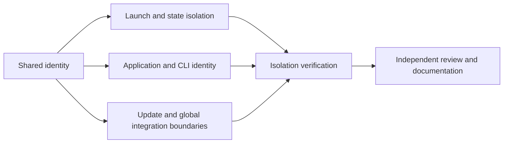

# RFC-0001: Product identity and local isolation

- Status: implementing; T1–T5 implemented, remote CI pending
- Owner: root implementation agent
- Architecture review: Fable 5.1, initial source review on 2026-10-28
- Code review: Opus 5.5; implementation reviewed on 2026-10-28, no remaining blocking findings at 02:34; final commit and CI review pending
- Base: `de50243885ff47e0dc9c26233327fe066befa684`
- Decision authority: the maintainer delegated implementation choices to the three agents for the overnight development session. Acceptance here records an agent decision, not human review of this document.

## Problem and outcome

The imported application shares Paseo's identity, storage defaults, launch environment, update channels, and global integration paths. Starting a candidate from an agent hosted inside Paseo can inherit the installed application's home directory. A separate daemon home alone also fails to isolate automatic skill installation into the user's harness directories.

Malleaf must be able to start and run tests beside an installed Paseo without contacting its daemon, modifying its state, overwriting its CLI, or updating itself back to Paseo. Establish this boundary before starting any customization candidate.

## Design

Keep the upstream package layout and `@getpaseo/*` internal package names. Put Malleaf's shared, platform-independent identity constants in a new protocol leaf module; put environment and startup helpers in Malleaf-specific directories. Existing integration points import the shared identity rather than spreading new defaults across unrelated code.

The protocol package is already consumed by server, app, CLI, and desktop. The identity leaf contains no Node, browser, Electron, persistence, or process behavior. A separate controller package will be introduced by the runtime RFC because it has an independent process lifetime; a constants-only workspace is unnecessary at this stage.

Malleaf uses its own application name, bundle identifier, URL scheme, CLI command, default port, and state root. `MALLEAF_HOME` names the Malleaf root; daemon state belongs under its `daemon/` directory. Development uses checkout-specific state outside the source tree. An inherited `PASEO_HOME` is not authority to reuse an installed Paseo home. The Malleaf launch boundary selects and validates its own state path and passes the resolved path to upstream code explicitly.

At each public CLI, development, or desktop boundary, discard every inherited `PASEO_*` value before translating an allowlist of `MALLEAF_*` options for internal upstream modules. Preserve the original host home for path comparisons across nested launches. Resolve existing ancestors and dangling symlinks before creating directories; reject overlap with installed Paseo daemon and desktop storage, including a custom inherited daemon home. Explicit `--home` remains an intentional local target subject to the installed-home guard.

Development scripts derive `~/.malleaf-dev/<checkout-path-hash>/daemon` and a loopback port in 30000–49999. Managed workspace services may supply an explicit loopback port. They ignore inherited Malleaf homes and ports, so customizing Malleaf from within Malleaf cannot reuse the parent runtime. Port collisions fail at bind; no running instance is reused. Production defaults use `~/.malleaf/daemon` and port 6777. Disable all three automatic seed entrances: worktree setup no longer invokes the state/environment copier, development shell startup has no seed operation, and Playwright rejects `E2E_FORK_PASEO_HOME_FROM=current`. Explicit disposable test fixtures remain supported.

Candidate CLI launches require an explicit absolute `MALLEAF_DAEMON_ENTRY`; a missing entry never falls back to checkout dist. The builder must clean and successfully build before supplying it. Development selects the source supervisor explicitly. Acceptance checks the running process entry, with immutable build identity added in RFC-0002.

Global skill operations never enter the upstream skills controller: even its status operation can recover interrupted transactions and write harness directories. Status is an empty Malleaf ownership snapshot; reconcile, uninstall, and selection mutation are rejected. Terminal hooks skip both installation and uninstallation, including the configuration listener. Persisted enablement is ignored and runtime enablement is rejected. Per-session provider configuration and MCP injection continue to use the existing harness adapters. Namespaced, explicitly requested global integrations can be designed separately.

Malleaf's product version starts at `0.1.0` in a separate manifest. Existing workspace versions retain the upstream value so protocol and plugin compatibility checks retain their meaning. Personal display versions and immutable build identity are defined by the runtime RFC.

Paseo's desktop updater and npm self-update path are disabled for Malleaf. Internal packages are not published under the upstream namespace. The GitHub repository keeps CI enabled and inherited publication/deployment workflows disabled. Public upstream service URLs are inventoried: a feature must either identify an explicitly chosen upstream service or be disabled until Malleaf provides a working destination. Do not invent service URLs.

## Contracts and constraints

- Standalone runtime defaults never target `~/.paseo`, port `6767`, the `paseo` CLI, or the `paseo` URL scheme.
- Development and candidate launchers derive isolated homes even when invoked from a Paseo agent.
- Candidate and test startup cannot synchronize global skills or install harness hooks.
- A failed build is a failure. Existing `dist` files are not an acceptable fallback for a candidate.
- Backend tests use temporary homes and real subprocesses where process lifecycle is the behavior under test.
- Changes to protocol messages remain optional and capability-gated; this RFC's identity constants do not add wire fields.

## Alternatives

**Rename or move all upstream packages.** Rejected: more than a thousand files reference the existing namespace, and the frequently changed upstream integration files would become expensive to merge.

**Rely only on `PASEO_HOME`.** Rejected: it is inherited by agent subprocesses, and global skill paths use the operating-system home independently.

**Perform all integration in a plugin.** Useful for future UI, RPC, and commands, but insufficient for startup defaults and update ownership. The version controller must also outlive the daemon it replaces. Later RFCs should prefer plugin seams when they can satisfy the contract.

## Tasks and dependencies

| Task | Scope                                                              | Dependencies | Owner       | Status      | Acceptance                                                                                 |
| ---- | ------------------------------------------------------------------ | ------------ | ----------- | ----------- | ------------------------------------------------------------------------------------------ |
| T1   | Shared identity and separate product manifest                      | None         | root        | implemented | All consumers use consistent defaults; upstream compatibility versions stay unchanged      |
| T2   | Development/candidate environment, explicit entry, and daemon home | T1           | root        | implemented | An inherited Paseo environment cannot redirect startup into the installed home or endpoint |
| T3   | Desktop, CLI, app defaults, and link identity                      | T1           | root        | implemented | Malleaf has distinct identities and does not install or discover Paseo by default          |
| T4   | Updaters, publication, global skills/hooks, and service inventory  | T1           | root        | implemented | No automatic upstream replacement or global harness file writes                            |
| T5   | Focused isolation and lifecycle checks                             | T2, T3, T4   | root        | implemented | Temporary fixture state and a sentinel endpoint prove the isolation contracts              |
| T6   | Review findings, documentation, and CI evidence                    | T5           | Opus / root | pending     | Review findings resolved; checks and remaining limits recorded accurately                  |

## Verification

Use fixture directories for both the simulated installed Paseo and Malleaf. Seed distinctive harness settings and skill files, hash them, launch the actual subprocess, and prove that hashes remain unchanged. Exercise inherited variables and symlink aliases. A sentinel endpoint must receive no connection from the isolated launch path.

Check updater behavior without real publication: no download/install command may target the upstream distribution. Verify CLI and desktop defaults through the existing relevant suites. Complete typecheck, lint, build, and focused tests; use remote CI for broad coverage. Real-harness tests are separate from mock-provider tests and require explicit evidence.

Every evidence record includes the command, source commit or working-tree description, exit status, and log/artifact location. Independent reviewers may rerun targeted tests when a finding or an unresolved concern warrants it.

## Evidence and current limitations

- Fable reviewed the source and recommended retaining Paseo and the imported main commit.
- Opus's baseline review identified inherited-home leakage, global skill synchronization, and stale-dist fallback as prerequisites for self-modification testing.
- On the initialization commit `404f2ffab`, dependency installation, `build:server`, typecheck, and lint passed locally. These establish a source baseline, not proof of this RFC's implementation.
- Remote baseline CI: [run 40548894786](https://github.com/xilinshancun/malleaf/actions/runs/40548894786), the website sponsor test failed because the original READMEs were relocated. Its references now point at the preserved upstream READMEs; all six focused sponsor tests passed. Build and typecheck in that job passed, but checks after the website failure were skipped. Its real-provider coverage is not assumed: no provider secrets were configured in this new repository.
- Version slots, data recovery, agent-driven modification, and desktop slot loading are follow-up RFCs. This document does not claim those features are implemented.

- Working-tree verification: shared identity compiled with `npm run build:client`; focused home, global-skill, and production-updater checks passed (12 tests, `/tmp/malleaf-isolation-unit.log`). These precede the final isolation acceptance and are not a claim that the RFC is complete.
- Test-fixture protection: server Vitest supplies a disposable daemon home. Real subprocess acceptance additionally redirects `HOME`, `USERPROFILE`, `CODEX_HOME`, and `CLAUDE_CONFIG_DIR`. Provider-authenticated suites remain separate and do not inherit a claim of mock-test coverage.

## Upstream service inventory

| Surface                        | Initial policy                                                                                                   |
| ------------------------------ | ---------------------------------------------------------------------------------------------------------------- |
| Desktop GitHub updater         | Feed metadata names `xilinshancun/malleaf`; download/install disabled until a signed bootstrap release exists    |
| Daemon npm self-update         | Production RPC returns an explicit unsupported result; never installs `@getpaseo/cli`                            |
| Relay                          | Disabled by default; the existing upstream endpoint is available only after explicitly enabling that integration |
| Hosted app URL                 | Defaults to the local Malleaf web endpoint                                                                       |
| Hub and public plugin registry | Existing upstream services remain named as upstream integrations; no invented Malleaf cloud endpoint             |
| Mobile EAS ownership           | Upstream owner/project ID removed; mobile distribution is unconfigured                                           |
| Global skills and hooks        | Disabled on the server and hidden in Malleaf settings; provider binaries and auth remain user-owned              |

### Review follow-up: self-hosted development and test entry points

Development derives identity from the launcher repository (canonicalized before hashing), even when called by absolute path from another checkout. It discards all inherited product options and session context; the explicit `--listen` argument is the service-port override. External agents/editors only inherit the documented Malleaf target and session context allowlist; new runtime controls default to stripped. Daemon launches never inherit an agent's session identity.

Playwright uses disposable OS/provider directories by default. `npm run test:e2e:real --workspace=@getpaseo/app -- <spec>` explicitly enables the installed Claude/Codex profiles while retaining disposable daemon/OS state; it optionally seeds the current checkout's development metadata. Published upstream daemon fixtures cannot enable this mode because they still own global integration behavior. Mock suites do not prove real-provider operation.

The connection-offer subprocess listening check now binds loopback. It asserts startup and no-relay behavior, not LAN reachability; the other connection-offer tests still cover generated LAN-independent relay offers. Browser fixtures block both installed Paseo and Malleaf default ports.

### Local acceptance evidence (2026-10-28)

Subject: foundation commit `96a494b8d4c415e603b2c92aef258fe3ce918cf0`, scheduler fixture correction `a48011a67a79b491bdf9ef36aefeed78148684f3`, and follow-up CI fixture corrections in [PR #1](https://github.com/xilinshancun/malleaf/pull/1). All local commands ran from this repository with Node 22.23.4 on macOS arm64. No user daemon was restarted.

| Check                                                                            | Result                                                                                                                                                               | Local log                                                                        |
| -------------------------------------------------------------------------------- | -------------------------------------------------------------------------------------------------------------------------------------------------------------------- | -------------------------------------------------------------------------------- |
| `npm ci --no-audit --no-fund`                                                    | Exit 0; old `.bin/paseo` absent, `.bin/malleaf` resolves inside this repository                                                                                      | `/tmp/malleaf-fresh-npm-ci.log`                                                  |
| `npm run build:server`, `npm run typecheck`, `npm run lint`                      | Exit 0; all workspace types passed; lint 0 warnings/errors                                                                                                           | `/tmp/malleaf-rfc0001-{build,typecheck,lint}.log`                                |
| Vitest `paseo-home.test.ts`, `paseo-env.test.ts`                                 | 24 passed; absolute launcher from different cwd, parent Malleaf, session/control environment                                                                         | `/tmp/malleaf-self-host-isolation.log`                                           |
| Vitest config/global update boundary checks                                      | 83 passed in the combined home/env/config/updater check; global skills controller separately passed 43 with one existing skip                                        | `/tmp/malleaf-isolation-focused.log`, `/tmp/malleaf-skills-controller-tests.log` |
| Vitest CLI lifecycle `-t Malleaf`                                                | 3 passed, 19 intentionally filtered; real Paseo-parent and Malleaf-parent subprocess scenarios, no sentinel connections, unchanged host files, selected entry hashes | `/tmp/malleaf-isolation-process.log`                                             |
| CLI foundation, daemon commands, stop ownership after clean install              | All three files passed; each explicitly executes repository CLI with disposable OS home                                                                              | `/tmp/malleaf-fresh-cli-tests.log`                                               |
| Desktop packaging and node entrypoint                                            | 15 passed; includes executing the actual shim against a fixture bundle                                                                                               | `/tmp/malleaf-desktop-identity-tests.log`                                        |
| Terminal CLI lookup                                                              | 1 passed, 63 filtered; resolves renamed CLI after clean install                                                                                                      | `/tmp/malleaf-terminal-cli-test.log`                                             |
| Playwright `settings-host-page.spec.ts --grep 'password reconnects' --workers=1` | 1 passed; real browser plus isolated worker and password-protected secondary daemon; clean shutdown                                                                  | `/tmp/malleaf-playwright-isolation.log`                                          |
| `node packages/desktop/e2e/daemon-lifecycle.e2e.mjs` after `build:main`          | Exit 0; real Electron lifecycle, attached-daemon ownership, restart, settings, and slow-start recovery                                                               | `/tmp/malleaf-desktop-lifecycle.log`                                             |

Limitations: the complete signed/packaged desktop application has not been built or launched; packaging hooks have fixture coverage. Entry hashes are diagnostic provenance, not a manifest proving the latest complete build (RFC-0002 owns that). Real-provider tests were not run in this RFC. Windows/mobile behavior awaits CI/platform validation. Explicit relay enablement still selects the upstream relay unless a different endpoint is configured. Development accepts `--listen`; the ineffective inherited skip-build flag was removed.

### Remote CI findings and focused corrections

[Run 40562394033](https://github.com/xilinshancun/malleaf/actions/runs/40562394033) on `96a494b8d` passed typecheck, including the website and public package checks. Before being superseded it failed protocol/default-port assertions, CLI fixture home/target selection, App localhost expectations, and desktop fixtures. Opus independently traced those failures to tests that still assumed upstream identity or configuration. The desktop attachment fixture also exposed a real test-isolation gap: it used an ignored `PASEO_HOME` and could write default Malleaf state. Desktop tests now initialize disposable OS, product, and provider directories at suite entry.

Follow-up acceptance: CLI files 04, 17, 25, 28, and 31 passed against real isolated daemons; protocol host-target tests passed 25; App host-runtime passed 103; desktop attachments/navigation/update boundary passed 16, with 9 Linux launcher cases skipped on macOS and deferred to CI. Logs are `/tmp/malleaf-ci-cli-fix-*.log`, `/tmp/malleaf-ci-{protocol,app,desktop}-fixes.log`; typecheck and lint passed in `/tmp/malleaf-ci-fixes-{typecheck,lint}.log`. The disabled production updater is now tested for making no upstream requests; generic updater error behavior remains covered by `app-update-service.test.ts`.

[Run 40563736857](https://github.com/xilinshancun/malleaf/actions/runs/40563736857) additionally exposed legacy relay-default and hook-toggle assertions, plus a CLI subprocess fixture still supplying upstream agent identity. Malleaf requires explicit relay opt-in even for imported configurations, refuses global hook installation, and accepts session context at the CLI boundary only through its own namespace. After correcting those fixtures, 25 config/hook tests passed and the real connected-host report test passed (27 unrelated cases filtered), logged in `/tmp/malleaf-ci-server-unit-fixes.log` and `/tmp/malleaf-ci-connected-hosts-fix.log`.

[Run 40567442093](https://github.com/xilinshancun/malleaf/actions/runs/40567442093) on `35d36909f` passed typecheck, quality, App tests, Windows desktop tests, and CLI shard 2. CLI shards 1 and 3 exposed password and caller-identity fixtures still supplying ignored upstream environment variables. Those inputs now use `MALLEAF_*`; CLI recovery messages also name the usable password variable and command. A focused scan corrected the remaining `ls` endpoint fixtures and the local relay fixture, including its explicit app URL. Files 04, 32, 34, 38, and 41 and the local relay E2E passed after rebuilding the CLI (`/tmp/malleaf-cli-boundary-*.log`). Server unit tests passed 7029 cases (55 skipped); three relay integration cases failed because their pairing helper omitted an explicit app URL. Correcting that helper produced 10 passing relay-transport cases (`/tmp/malleaf-relay-transport-fix.log`). Hub command hint checks passed 20 cases (`/tmp/malleaf-cli-hub-hints.log`). Typecheck and lint passed, and Opus reviewed the complete correction diff with no blockers. The live hosted relay helper received the same explicit URL correction but was not run. Remaining platform/browser CI results are still being evaluated.

Cancelled jobs are not passes. Final-head remote CI and independent review remain required before marking this RFC verified.
