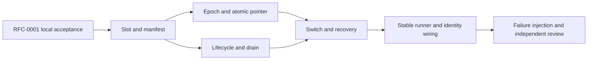

# RFC-0002: Personal runtime slots and paired data epochs

- Status: implementing; pure file operations may proceed on RFC-0001 local acceptance
- Owner: root implementation agent
- Architecture: Fable 5.1 source audits, 2026-10-28
- Independent code reviewer: Opus 5.5
- Authority: maintainer-delegated overnight implementation decisions; no claim of human document approval

## Outcome

Build a changed Malleaf daemon, activate the exact tested artifact, and return to the previous working runtime when startup fails or its owner chooses to revert. A personal version can change every project layer, including storage. A rollback therefore selects both code and its corresponding data. Provider binaries and provider-owned conversation history remain external dependencies.

The directory structure and `@getpaseo/*` packages stay in place to retain upstream mergeability. `packages/malleaf-controller` owns the controller and stable runner. The later job/agent and desktop RFCs add conversational entry points and desktop slot loading; this RFC must not label those later features complete.

Fable and root agreed on 2026-10-28 to implement the pure file portions of T1 and T2 on the locally accepted RFC-0001 foundation while PR #1 runs CI. The runtime branch now includes foundation correction `80e2743fc`. Candidate process startup, including the copied-closure acceptance test, remains gated on that CI result. Runtime work is a separate branch and commit series.

## Layout and process ownership

```text
MALLEAF_HOME/
  runner/stable/runner.js       last validated, dependency-free bootstrap
  runner/runner.json           fixed control port, init token, initial pair
  runner/current.json          current, previous, trial build/data pairs
  runner/controller.json       listener owner's identity; not a file lock
  runner/switch.json           recoverable transaction journal
  versions/<buildId>/          immutable runtime closure and manifest
  data/<dataId>/               one complete daemon home per epoch
  source/                     user source clone and personal branch
  worktrees/                  shared worktrees outside daemon state
  plugins/                    shared installed plugin checkout contents
  models/                     shared model downloads
  jobs/                       durable customization jobs (next RFC)
```

The stable runner starts the current slot's controller. The controller starts and supervises the daemon through the public daemon-control and client APIs. It survives a daemon replacement. UI/RPC integration later uses a built-in plugin as a thin authenticated bridge; it is not required for rollback or crash recovery.

The stable runner is a last validated copy, rather than an officially locked source component. Its source remains customizable. Updating the installed stable copy requires a separate validated handoff transaction. Initial implementation establishes this layout; the handoff transaction may follow. A signed desktop bootstrap still requires repackaging when that bootstrap changes; the future desktop RFC must distinguish that from replaceable main/preload/renderer code.

## Version identity and artifact contract

Keep upstream workspace and protocol versions unchanged. `malleaf.json` records Malleaf's product version (initially `0.1.0`). A personal display string such as `0.1.0.alice-1` is presentation metadata, never a replacement for npm semver or `requirements.paseo` compatibility.

Each slot records product/display version, source commit, upstream commit, builder identity, build time, and a file inventory with sizes and hashes. Following Opus’s first implementation review, root includes the sorted inventory, executable entry mapping, and provenance in `buildId`. The manifest file itself is excluded to avoid self-reference. Changing a display version or entry mapping produces a new build identity even when executable bytes are identical; verification also requires the expected identity and matching directory name. Runtime `server_info.malleaf` is optional and includes product/display/buildId/upstream. Consumers compare build identities when both sides report them.

Build cleanly before materialization. Use the existing `trace-daemon.mjs` runtime-closure approach and physically copy workspace packages. Recreate workspace links only inside the slot. Reject missing entries, escaping links, incomplete copies, or any failed required gate; never reuse stale worktree dist. Atomically rename a fully materialized staging directory into `versions/<buildId>`.

At every launch, verify the executable entry and registered resource hashes. Activation also requires full inventory verification; `malleaf doctor` can repeat it independently. Read-only permissions are an accidental-write guard. These hashes detect incomplete or changed artifacts. They do not authenticate against a local process that can rewrite both files and manifests. Candidate build scripts run arbitrary code; sanitized environment and redirected HOME reduce accidental writes and do not constitute a sandbox.

## Data and rollback contract

The atomic pointer selects `{buildId, dataId}`. After draining and stopping the old daemon, clone its durable state into a new epoch for the candidate. The previous pair remains intact. Returning to the previous pair retains the trial epoch: trial-created agents and settings become visible again when that trial pair is selected. Provider histories, project source changes, terminal side effects, and shared resources are outside the epoch boundary.

Copy by default, explicitly excluding runtime state. This preserves storage introduced by custom code without requiring the old builder to know every filename. Current known durable state includes agents, projects/workspaces/labels/icons, schedules, finish subscriptions, request receipts/creation journals, plugin settings, Hub relationship, push tokens, CLI identity, desktop attachments, `server-id`, and `daemon-keypair.json`. Identity files must be copied, not regenerated.

Exclude pid lock, local credential, logs/rotation, sockets, `runtime/`, uploads, and obsolete agent timelines. Keep worktrees, installed plugin contents, and models shared outside each epoch. Installed plugin source metadata (`plugins/sources.json`) is shared with the checkout contents. Rewrite config paths under the old epoch's `plugins/` to the new epoch's `plugins/` alias. A trial uninstall can remove a shared plugin checkout; rolling back may then leave that plugin unavailable without blocking daemon startup. The first file-copy implementation refuses embedded shared directories before writing anything. Import migration is a separate transaction: models and plugin contents can be relocated, but Git worktrees must retain their original location as declared legacy shared resources until archived/recreated. The importer must preserve those references rather than move worktree directories with ordinary filesystem operations.

Copy to `data/<id>.partial`, record provenance and hashes, then atomically rename. Use `lstat`; never follow an escaping link. Preserve internal links by rebasing them into the new epoch. For an unknown external link, stop with an actionable decision rather than silently discard possibly durable user data. The current trusted slot owns the data policy (`malleaf.data-policy.json`); undeclared paths default to copied. Large unknown data needs a copy/share decision before activation. Failed or cancelled staging leaves the previous pair usable. Scan every copied JSON document and the rewritten config for paths into the source epoch; unresolved paths block copying. The scanner currently fails closed on malformed JSON or invalid file URLs; paths embedded in shell commands and home-relative strings require declared migration work. Binary/custom formats and code side effects are not a sandbox boundary. Storage destinations and shared targets reuse RFC-0001’s installed-Paseo path protection. Windows directory symlinks currently require developer mode or symbolic-link privileges; ordinary-user Windows activation is not yet accepted.

Epochs are not automatically removed. Code-only rollback while retaining trial data requires a separate compatibility proof and is deferred. This avoids relying on arbitrary modified code or Zod parsing to promise backward-compatible writes.

### Durable pointer and initialization

`current.json` is the sole commit point. It stores schema/minimum reader/minimum writer versions, a monotonically increasing sequence, current and previous pairs, an optional `trial {pair, switchId, candidateToken, since}`, update time, and writer identity. Beginning a trial leaves current/previous unchanged. Keep atomically promotes the trial, retains the old current as previous, and clears trial. Revert only clears trial. Returning to a previously kept build first clones its retained epoch, then uses the same trial/keep protocol. Current, previous and trial use distinct epochs. No timer implicitly keeps a trial.

Initial publication and forward transitions require complete physical slot/epoch directories within the product home; they verify slot entry hashes and epoch/build identity. Reading an existing pointer and clearing trial do not validate referenced files, so damaged epoch metadata cannot block removing a trial. Keep/revert require both switch identity and candidate token. Full slot verification belongs to activation. The store preserves unknown state fields and accepts a future schema only when its minimum reader version permits this reader; a higher minimum writer version permits inspection but rejects mutations. Writer identity is replaced on each commit. Unsupported or malformed state is never overwritten.

Writes run in one promise queue. Each operation rereads the sequence and exact file digest; an unexpected change poisons that store instance. The controller supplies an ownership guard, checked before reading and immediately before publication. A failed commit may already have reached disk, so it also poisons the instance instead of retrying cached state. `seal()` rejects new operations and waits for accepted operations before the listener can be handed off. The file digest detects external writes; it cannot prevent two writers racing between read and rename. The file layer does not itself provide cross-process exclusion; the exclusive control listener is required before these stores can drive a runtime.

Atomic replacement writes and fsyncs a private temporary file, renames it, then syncs the parent directory on POSIX. Initial publication uses a hard link from that complete temporary file and fails if the destination exists. A filesystem without that primitive receives an explicit failure; there is no partial direct-write fallback. Windows directory fsync is not used.

Initialization will hold its selected loopback listener while publishing `runner.json`, including the exact initial pair. If it crashes before publishing `current.json`, recovery uses that recorded pair rather than new command arguments. Losing initializers do not delete complete epochs; explicit cleanup can reclaim unreferenced artifacts later. The initialization module implements this protocol; daemon startup remains separate. Initial allocation tries 32 candidates in 20000–32767, outside common default ephemeral ranges. Later starts use the recorded port without automatic reassignment. `epoch.json` is reserved controller metadata inside the epoch; same-user custom code can damage it. Forward transitions then fail closed. Clearing trial remains possible, but this alone does not repair state or prove the old daemon can boot.

### Controller ownership

All controller roles bind the same configured IPv4 loopback address, `127.0.0.1`, and a fixed nonzero control port. Acquisition only binds; publishing `controller.json` is a separate operation after initialization wins its create-once election. This prevents two initializers reserving different ports from overwriting the same advisory identity. An occupied port is identified for diagnostics and always refused; timeout, stale files and heartbeat age never authorize takeover.

The listener only serves bounded, unauthenticated identity queries in this slice, without exposing its token. A canonical-home SHA-256 fingerprint distinguishes the same home’s owner from a different Malleaf home occupying the port. This detects collisions after initialization; stopped homes do not reserve an OS port. It does not accept runtime commands. Release first waits for the pointer store to seal; a rejected or hung seal leaves ownership held. After successful sealing, it removes only its own token-matching identity while still listening, then closes connections and the listener. A retained `.stale` file records the previous advisory identity without accumulating a file per restart. Identify clients initiate disconnect after reading the reply to avoid leaving server-side TIME_WAIT during Windows restart.

This mutex coordinates cooperating Malleaf processes on one machine. It does not support a home shared across machines or prevent a hostile local program from using platform-specific socket reuse options. Node's `exclusive` flag prevents cluster handle sharing; cross-process tests, rather than that flag alone, supply platform evidence. Linux and Windows remain CI gates for same-address exclusion and immediate rebind. A service starting on the recorded port later requires freeing that port or an explicit future doctor reassignment; initialization cannot reserve a port while stopped. Public home fingerprints are diagnostics, never credentials.

## Drain, switch, and recovery

A controller-only idle check has a race with incoming prompts and schedules. Add a daemon-owned draining state with expiry, block new agent registrations and new turns, and pause schedules. Existing turns continue. Keep the WebSocket channel available for status, permission resolution, cancellation, and shutdown. Reusing `wsServer.prepareForShutdown()` would silence the controller too; it is not the drain mechanism.

Before draining, cold-start the candidate in a sanitized disposable home on `127.0.0.1:0`, check identity and behavior, and stop that exact process. Use daemon-control deployment mode with a constructed environment; managed mode strips listen/model overrides. Persist shared worktree/model paths in epoch config as well.

The controller begins draining, waits for running/initializing turns and pending permissions to clear, then stops the exact identified supervisor. Timeout pauses the operation with product-language choices; it does not grant permission to interrupt a turn. Cancelling or losing the controller releases the drain lease. The manager must expose reversible registration freeze and block new prompts at its admission point. Poll agent status during drain; waitForFinish is unavailable while registrations are frozen. Schedule restart on cancellation also runs upstream interrupted-run recovery. Active terminals and service scripts are disclosed because daemon replacement stops them.

Journal each step: requested, draining, stopped, copying, starting, probing, trial, kept, or rolled back. Only complete epochs and verified slots can be referenced. Startup health must match the expected buildId and server identity, then exercise a real behavior contract. The running trusted controller owns those verdicts; candidate verifier changes cannot approve the candidate itself.

On a failed candidate boot, stop the candidate if it exists, restore the previous pair, and probe recovery. Bound automatic retries (two attempts per pair). If both fail, retain both data sets and diagnostic logs and stop retrying. A stable runner restart must recover from any journal step without launching two daemons against the same state or port. Serialize all pointer-changing operations under the controller’s exclusively bound loopback control socket; `runner/controller.json` records identity but is not an OS lock. Do not reclaim ownership from heartbeat age, a socket timeout, or a racy file rename; persist the controller client identity under `runner/`, using clientType `cli`.

### Recovery decisions

| Durable phase        | Recovery action                                                                  |
| -------------------- | -------------------------------------------------------------------------------- |
| requested / draining | Release drain when possible; retain the old pair                                 |
| stopped / copying    | Discard only incomplete `.partial` staging; start the old pair                   |
| starting / probing   | Stop only the recorded candidate pid + startedAt; restore and probe the old pair |
| trial                | Retain the trial pair; wait for keep or revert                                   |
| kept / rolled_back   | Terminal record; boot the selected pair                                          |

The controller hashes the selected entry itself and checks the supervisor pid/startedAt and the hello buildId against the slot manifest. Candidate-written `runtime/malleaf-entry.json` is diagnostic information, not authoritative verification. The old epoch stays untouched while inactive; starting it again may perform its normal persistence writes.

The first supported baseline includes reversible drain and runtime identity. A daemon without these capabilities requires a stopped-state import; an idle observation is not a safe fallback for draining. Existing desktop daemon ownership and attachment paths must follow the selected epoch, with built-in daemon management disabled while the controller owns the runtime.

## Tasks



| Task                                                                          | Owner       | Status      | Required evidence                                                                                                           |
| ----------------------------------------------------------------------------- | ----------- | ----------- | --------------------------------------------------------------------------------------------------------------------------- |
| T1: Controller workspace, artifact manifest, materializer, hash verification  | root        | in-progress | Real copied closure starts; missing/escaping/changed entry fails; CI/build/knip include new workspace                       |
| T2: Default-copy epoch policy, shared resource handling, atomic pair store    | root        | in-progress | Unknown durable file retained; credentials/runtime excluded; partial epoch never selected; original data unchanged          |
| T3: Public daemon lifecycle adapter and reversible drain lease                | root        | pending     | Real supervisor start/stop; incoming turn rejected while existing turn drains; schedule pause/resume; expiry releases lease |
| T4: Journaled activation, keep/revert, automatic failure recovery             | root        | pending     | Healthy switch, failed startup, interrupted transaction, duplicate request, and previous-pair recovery                      |
| T5: Stable runner, optional build identity, desktop/controller ownership seam | root        | pending     | Actual reported buildId changes; fallback survives candidate failure; desktop does not resurrect an old epoch               |
| T6: Acceptance and code review                                                | root / Opus | pending     | Targeted process E2E with isolated HOME, evidence logs, review findings resolved, clear limits                              |

## Verification limits

### File-layer implementation evidence

The first implementation covers slot materialization and verification, two-phase epoch planning/copying, and workspace/CI integration. The next file-layer slice adds the pair store and create-once JSON publication. Listener ownership and initialization are implemented as isolated modules; controller lifetime, drain, activation, and desktop loading remain pending. T1 and T2 therefore remain in progress.

A real dependency trace produced 2599 paths, including a spurious checkout `.git/index`. The Malleaf tracer now excludes Git metadata and the materializer rejects it independently, including case variants. Ten materializer checks passed (`/tmp/malleaf-slot-metadata-tests.log`). The filtered trace has 2598 paths. A copied runtime with 2552 inventory records passed full hash validation (`/tmp/malleaf-materialized-slot.json` and `.log`); the source was the explicitly recorded development worktree and this was not a release build. No process was started from that slot. Sharing requires a later explicit artifact-content policy; this exclusion is not a claim that arbitrary builds are safe to publish.

On 2026-10-28, 18 targeted tests passed across `slot/materialize.test.ts`, `data/epoch.test.ts`, and `dependencies.test.ts` (`/tmp/malleaf-storage-review-tests.log`). They cover detached source closure fixtures, entry tampering, directory identity, installed-Paseo protection, unknown data preservation, source changes during planning, absolute paths in custom JSON, and copying between sibling epochs. Controller typecheck/lint and `build:server` passed (`/tmp/malleaf-runtime-{types,lint,server-build}.log`). The existing CI routing contract passed 21 checks (`/tmp/malleaf-runtime-ci-contract.log`). Opus’s second review closed all three P1 findings; the file-layer implementation has no remaining review blocker. A real copied runtime has not been started.

The pointer slice passed 31 targeted checks across those files plus `runner/pointer.test.ts` (`/tmp/malleaf-pointer-final-tests.log`). These include concurrent publication, stale writer detection, lease loss before commit, sealed queues, future reader/writer requirements, cloned rollback epochs, token checks, and clearing a trial after epoch metadata corruption. Full workspace typecheck, lint, server build and controller build passed (`/tmp/malleaf-pointer-{types,lint,server-build,controller-build}.log`). Opus's final pointer review found no remaining blocker. These file tests do not prove process exclusion or runtime recovery.

Seven real socket/process lease tests and four dependency checks passed on macOS (`/tmp/malleaf-lease-final-tests.log`). They verify a competing process cannot bind, owner death releases the port, identity queries do not expose the token, foreign/quiet listeners are refused, sealing retains ownership, and release permits immediate rebind. Opus reviewed the lease and its failure behavior with no blocker. These checks do not exercise daemon replacement or Windows socket semantics. Initialization adds real-filesystem and subprocess checks for the publish election, recovery of the recorded pair, occupied ports across homes, malformed/orphaned state, and damaged trial references. Its combined initialization/pointer/lease/dependency run passed 31 checks (`/tmp/malleaf-init-tests.log`), full workspace typecheck and lint passed (`/tmp/malleaf-init-{types,lint}.log`), and Opus's final review found no blocker. A repeated initializer reports `resumed` with the actual stored pair even when given a different requested pair; the future CLI must display that difference. Missing recorded artifacts require an explicit repair operation in a later doctor command. Such repair may replace initialization only while `current.json` is absent and after validating a supplied replacement pair; no automatic reset exists.

Unit tests alone do not prove activation. Required process acceptance uses a copied slot and new epoch, confirms runtime build identity and behavior, and proves the previous epoch remains byte-for-byte recoverable after candidate failure. Mock-provider checks and real installed harness checks are reported separately. Local tests remain targeted; full-suite execution belongs to CI.

This document is design agreement, not implementation evidence. The first complete product demonstration still requires a visible UI change and a backend/orchestration change, as stated in the product brief.
