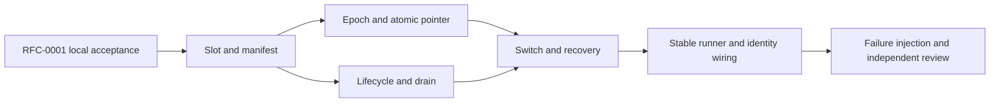

# RFC-0002: Personal runtime slots and paired data epochs

- Status: implementing; RFC-0001 verified, T1 implemented with committed copied-runtime evidence
- Owner: root implementation agent
- Architecture: Fable 5.1 source audits, 2026-10-28
- Independent code reviewer: Opus 5.5
- Authority: maintainer-delegated overnight implementation decisions; no claim of human document approval

## Outcome

Build a changed Malleaf daemon, activate the exact tested artifact, and return to the previous working runtime when startup fails or its owner chooses to revert. A personal version can change every project layer, including storage. A rollback therefore selects both code and its corresponding data. Provider binaries and provider-owned conversation history remain external dependencies.

The directory structure and `@getpaseo/*` packages stay in place to retain upstream mergeability. `packages/malleaf-controller` owns the controller and stable runner. The later job/agent and desktop RFCs add conversational entry points and desktop slot loading; this RFC must not label those later features complete.

Fable and root agreed on 2026-10-28 to implement the pure file portions of T1 and T2 on the locally accepted RFC-0001 foundation while PR #1 runs CI. Foundation source commit `3b7455eda` completed all 21 jobs in CI run [40582559870](https://github.com/xilinshancun/malleaf/actions/runs/40582559870), and Opus approved RFC-0001 verification. The candidate-process gate is satisfied. Runtime work is a separate branch and commit series.

## Layout and process ownership

```text
MALLEAF_HOME/
  runner/stable/runner.cjs      last validated, dependency-free bootstrap
  runner/runner.json           fixed control port, init token, initial pair
  runner/current.json          current, previous, trial build/data pairs
  runner/controller.json       listener owner's identity; not a file lock
  runner/switch.json           recoverable transaction journal
  versions/<buildId>/          immutable runtime closure and manifest
  data/<dataId>/               one complete daemon home per epoch
  source/                     user source clone and personal branch
  worktrees/                  shared worktrees outside daemon state
  plugins/                    shared installed plugin checkout contents
  models/                     shared model downloads
  jobs/                       durable customization jobs (next RFC)
```

The stable runner starts the current slot's controller. The controller starts and supervises the daemon through the public daemon-control and client APIs. It survives a daemon replacement. UI/RPC integration later uses a built-in plugin as a thin authenticated bridge; it is not required for rollback or crash recovery.

The stable runner is a last validated copy, rather than an officially locked source component. Its source remains customizable. Updating the installed stable copy requires a separate validated handoff transaction. Initial implementation establishes this layout; the handoff transaction may follow. A signed desktop bootstrap still requires repackaging when that bootstrap changes; the future desktop RFC must distinguish that from replaceable main/preload/renderer code.

The first stable-entry slice requires an explicit `--acceptance-root`, a disposable product home and a fake OS home. Without that opt-in both runner and controller reject before opening owned stores or starting a daemon. It provides no real-user activation entry. The installed CommonJS file uses only Node built-ins, reads the persisted control port and pointer, verifies the selected controller entry hash and refuses ancestor dependency directories. After imports and read-only argument validation, the controller sends a versioned `loaded` IPC message and waits up to ten seconds for ACK. The parent disables fallback before sending ACK; lease acquisition and recovery happen afterward. Only entry verification or load failures before this boundary may try `previous` once. A ten-second pre-load deadline terminates only the runner's own unacknowledged child; a fallback waits for observed exit and late load messages receive no ACK. State errors, identity rejection, user interruption and any failure after `loaded` never fall back. `last-boot.json` records attempts and diagnoses without changing the pointer; a diagnostic write failure does not replace the child exit code. Both entry layers reject overlap with the real account's installed product paths independently of caller-controlled `TMPDIR` and require explicit nonempty `HOME`. Windows temporary directories beneath the account home remain allowed.

`installStableRunner` is separate from initialization. It requires both initialized documents, holds the lease at the recorded port, verifies a current/previous slot's runner entry, and publishes `runner.cjs` and its identity sidecar with create-once semantics. Matching bytes without a sidecar are repaired; different bytes require a later explicit handoff. Init does not automatically install the stable copy. Controller shutdown disconnects its client, seals stores and releases its lease while leaving the registered daemon alive. IPC disconnect before ACK exits without side effects; disconnect after ACK does not stop the controller. A subsequent runner receives the explicit `lease_held` diagnostic (72) without fallback; public identify information never authorizes adopting or killing that controller. OS service registration, terminal-session SIGHUP handling and desktop ownership remain outside the stable-entry slice; controller handoff is specified below.

## Version identity and artifact contract

Keep upstream workspace and protocol versions unchanged. `malleaf.json` records Malleaf's product version (initially `0.1.0`). A personal display string such as `0.1.0.alice-1` is presentation metadata, never a replacement for npm semver or `requirements.paseo` compatibility.

Each slot records product/display version, source commit, upstream commit, builder identity, build time, and a file inventory with sizes and hashes. Following Opus’s first implementation review, root includes the sorted inventory, executable entry mapping, and provenance in `buildId`. The manifest file itself is excluded to avoid self-reference. Changing a display version or entry mapping produces a new build identity even when executable bytes are identical; verification also requires the expected identity and matching directory name. Runtime `server_info.malleaf` is optional and includes product/display/buildId/upstream. Consumers compare build identities when both sides report them.

Build cleanly before materialization. Use the existing `trace-daemon.mjs` runtime-closure approach and physically copy workspace packages. Recreate workspace links only inside the slot. Reject missing entries, escaping links, incomplete copies, or any failed required gate; never reuse stale worktree dist. Atomically rename a fully materialized staging directory into `versions/<buildId>`.

At every launch, verify the executable entry and registered resource hashes. Activation also requires full inventory verification; `malleaf doctor` can repeat it independently. The lifecycle adapter checks every slot ancestor for `node_modules` before startup and disables Node global search paths. A missing dependency must fail instead of borrowing host code. This check is made at launch, not continuously. A home beneath an existing ancestor `node_modules` is refused; choose a product-home location without that ancestor rather than deleting user dependencies. Read-only permissions are an accidental-write guard. These hashes detect incomplete or changed artifacts. They do not authenticate against a local process that can rewrite both files and manifests. Candidate build scripts run arbitrary code; sanitized environment and redirected HOME reduce accidental writes and do not constitute a sandbox.

## Data and rollback contract

The atomic pointer selects `{buildId, dataId}`. After draining and stopping the old daemon, clone its durable state into a new epoch for the candidate. The previous pair remains intact. Returning to the previous pair retains the trial epoch: trial-created agents and settings become visible again when that trial pair is selected. Provider histories, project source changes, terminal side effects, and shared resources are outside the epoch boundary.

Copy by default, explicitly excluding runtime state. This preserves storage introduced by custom code without requiring the old builder to know every filename. Current known durable state includes agents, projects/workspaces/labels/icons, schedules, finish subscriptions, request receipts/creation journals, plugin settings, Hub relationship, push tokens, CLI identity, `server-id`, and `daemon-keypair.json`. Identity files must be copied, not regenerated.

Exclude pid lock, local credential, logs/rotation, sockets, `runtime/`, uploads, and obsolete agent timelines. Keep worktrees, installed plugin contents, and models shared outside each epoch. Installed plugin source metadata (`plugins/sources.json`) is shared with the checkout contents. Rewrite config paths under the old epoch's `plugins/` to the new epoch's `plugins/` alias. A trial uninstall can remove a shared plugin checkout; rolling back may then leave that plugin unavailable without blocking daemon startup. The first file-copy implementation refuses embedded shared directories before writing anything. Import migration is a separate transaction: models and plugin contents can be relocated, but Git worktrees must retain their original location as declared legacy shared resources until archived/recreated. The importer must preserve those references rather than move worktree directories with ordinary filesystem operations.

Copy to `data/<id>.partial`, record provenance and hashes, then atomically rename. Use `lstat`; never follow an escaping link. Preserve internal links by rebasing them into the new epoch. For an unknown external link, stop with an actionable decision rather than silently discard possibly durable user data. The current trusted slot owns the data policy (`malleaf.data-policy.json`); undeclared paths default to copied. Large unknown data needs a copy/share decision before activation. Failed or cancelled staging leaves the previous pair usable. Scan every copied JSON document and the rewritten config for paths into the source epoch; unresolved paths block copying. The scanner currently fails closed on malformed JSON or invalid file URLs; paths embedded in shell commands and home-relative strings require declared migration work. Binary/custom formats and code side effects are not a sandbox boundary. Storage destinations and shared targets reuse RFC-0001’s installed-Paseo path protection. Windows directory symlinks currently require developer mode or symbolic-link privileges; ordinary-user Windows activation is not yet accepted.

Epochs are not automatically removed. Code-only rollback while retaining trial data requires a separate compatibility proof and is deferred. This avoids relying on arbitrary modified code or Zod parsing to promise backward-compatible writes.

### Durable pointer and initialization

`current.json` is the sole commit point. It stores schema/minimum reader/minimum writer versions, a monotonically increasing sequence, current and previous pairs, an optional `trial {pair, switchId, candidateToken, since}`, update time, and writer identity. Beginning a trial leaves current/previous unchanged. Keep atomically promotes the trial, retains the old current as previous, and clears trial. Revert only clears trial. Returning to a previously kept build first clones its retained epoch, then uses the same trial/keep protocol. Current, previous and trial use distinct epochs. No timer implicitly keeps a trial.

Initial publication and forward transitions require complete physical slot/epoch directories within the product home; they verify slot entry hashes and epoch/build identity. Reading an existing pointer and clearing trial do not validate referenced files, so damaged epoch metadata cannot block removing a trial. Keep/revert require both switch identity and candidate token. Full slot verification belongs to activation. The store preserves unknown state fields and accepts a future schema only when its minimum reader version permits this reader; a higher minimum writer version permits inspection but rejects mutations. Writer identity is replaced on each commit. Unsupported or malformed state is never overwritten.

Writes run in one promise queue. Each operation rereads the sequence and exact file digest; an unexpected change poisons that store instance. The controller supplies an ownership guard, checked before reading and immediately before publication. A failed commit may already have reached disk, so it also poisons the instance instead of retrying cached state. `seal()` rejects new operations and waits for accepted operations before the listener can be handed off. The file digest detects external writes; it cannot prevent two writers racing between read and rename. The file layer does not itself provide cross-process exclusion; the exclusive control listener is required before these stores can drive a runtime.

Atomic replacement writes and fsyncs a private temporary file, renames it, then syncs the parent directory on POSIX. Initial publication uses a hard link from that complete temporary file and fails if the destination exists. A filesystem without that primitive receives an explicit failure; there is no partial direct-write fallback. Windows directory fsync is not used.

Initialization will hold its selected loopback listener while publishing `runner.json`, including the exact initial pair. If it crashes before publishing `current.json`, recovery uses that recorded pair rather than new command arguments. Losing initializers do not delete complete epochs; explicit cleanup can reclaim unreferenced artifacts later. The initialization module implements this protocol; daemon startup remains separate. Initial allocation tries 32 candidates in 20000–32767, outside common default ephemeral ranges. Later starts use the recorded port without automatic reassignment. `epoch.json` is reserved controller metadata inside the epoch; same-user custom code can damage it. Forward transitions then fail closed. Clearing trial remains possible, but this alone does not repair state or prove the old daemon can boot.

### Controller ownership

All controller roles bind the same configured IPv4 loopback address, `127.0.0.1`, and a fixed nonzero control port. Acquisition only binds; publishing `controller.json` is a separate operation after initialization wins its create-once election. This prevents two initializers reserving different ports from overwriting the same advisory identity. An occupied port is identified for diagnostics and always refused; timeout, stale files and heartbeat age never authorize takeover.

The listener only serves bounded, unauthenticated identity queries in this slice, without exposing its token. A canonical-home SHA-256 fingerprint distinguishes the same home’s owner from a different Malleaf home occupying the port. This detects collisions after initialization; stopped homes do not reserve an OS port. It does not accept runtime commands. Release first waits for the pointer store to seal; a rejected or hung seal leaves ownership held. After successful sealing, it removes only its own token-matching identity while still listening, then closes connections and the listener. A retained `.stale` file records the previous advisory identity without accumulating a file per restart. Identify clients initiate disconnect after reading the reply to avoid leaving server-side TIME_WAIT during Windows restart.

This mutex coordinates cooperating Malleaf processes on one machine. It does not support a home shared across machines or prevent a hostile local program from using platform-specific socket reuse options. Node's `exclusive` flag prevents cluster handle sharing; cross-process tests, rather than that flag alone, supply platform evidence. The file-layer CI evidence below includes Linux and Windows same-address exclusion and immediate rebind. A service starting on the recorded port later requires freeing that port or an explicit future doctor reassignment; initialization cannot reserve a port while stopped. Public home fingerprints are diagnostics, never credentials.

### Desktop ownership slice

Fable and root agreed on 2026-10-28 to add a read-only selected-epoch view before opening retained-data activation. Root owns this T5 slice. Only an absent runner directory preserves existing desktop behavior. An empty runner directory, missing pointer, unreadable/incompatible state or redirected path never authorizes a legacy daemon launch. Only current and published trial participate. Their epoch paths must be physical and contained, and two living selections produce a diagnostic instead of an arbitrary choice. A shared protocol projection carries build/data identity without making desktop depend on the controller package.

Desktop lifecycle requests must honor controller ownership even when no selected daemon is alive. Manual stop/restart is unavailable; desktop quit and application update leave that daemon alone. Status, local credentials and connection selection use the chosen epoch. The renderer preserves optional-field compatibility, requires the selected build identity before enabling local actions, and refreshes a changed listen address for the same serverId. The controller connection has its own persistent id; polling does not repeatedly override a user's preference or restore a host removed during the same app session. A new cold app session attaches the local selected runtime again, consistent with desktop startup semantics. This slice does not enable a controller launch on a real home. Desktop guards do not authorize lifecycle RPCs: other authenticated clients can still call restart/update/shutdown directly. Before real-user activation, daemon-side controller ownership must reject those operations or require controller authority, including a Windows-compatible shutdown path for the exact owned instance. UI controls alone are not that boundary. Same-build epochs also share serverId; current validation uses the selected endpoint and build, not a wire dataId. Desktop composer attachments belong to Electron userData, alongside the drafts that reference them. Writes and GC use `userData/desktop-attachments`; legacy references remain readable/deletable at the static daemon home, without migration or new writes there. Epoch copies exclude `desktop-attachments`.

This ownership slice has local evidence from 13 selection cases plus six dependency-export checks, desktop lifecycle/attachment unit tests, renderer attachment/identity/management tests, and a real Electron main-process test with two isolated supervisor starts and no providers. The latter verifies exact selected-home credentials, no-op quit/update/version checks, rejection of manual lifecycle commands, no legacy revival after stop or pointer corruption, and discovery of a different port under the same serverId. Endpoint replacement/rehydration is tested separately in the renderer store; this is not an end-to-end visual app acceptance or copied-slot activation.

### Candidate-controller handoff slice

The isolated handoff slice keeps stable as the sole controller parent. Private acceptance IPC forwards correlated activate/keep/revert/status requests only after readiness; it adds no network control operation. Before daemon preflight or draining, a candidate `--verify` process checks its own copied entry and readable state, reports verification and exits without receiving authority to acquire the lease. A failed self-check aborts with baseline untouched.

After successful keep and ledger promotion, C0 rejects new commands before sending the keep reply, sends that reply and a handoff notification, then disconnects its daemon client, seals writers and releases the listener. The reply uses the committed operation snapshot; a failed diagnostic status request cannot report that keep as failed. Relay tracks outstanding requests across the notification and reports controller exit for unanswered requests. Requests between controller cycles receive `not_ready`. Only completed cleanup exits 75. Stable requires both a valid notification and that clean exit, rereads the pointer, and requires current to equal the notified pair with a different controller build. It permits at most two handoff transitions and one pre-load previous-controller fallback per cycle. Diagnostic attempts record boot/handoff/fallback reasons. An unannounced 75, unchanged/mismatched current, signal, interruption or cleanup failure cannot trigger handoff.

Handoff and its fallback pass an explicit boot reason and permit recovery to attach only to a matching registered live selected daemon. They cannot start or restart a daemon, including one frozen in shutdown. Attach-only refers to process lifecycle: it may still finish selected-state bookkeeping, promote a committed registration, or release a matching selected boot gate. If the daemon dies during the handoff gap, the new controller reports an error without restarting it; a later cold boot can recover. Initial cold boot retains existing recovery behavior. If the parent disconnects before C0 can deliver its handoff notification, C0 stays alive on the committed pointer; it never rolls that pointer back. A copied fixture can fail normal controller loading while passing `--verify`, with valid manifest hashes, to exercise fallback to old controller code managing the newly selected daemon. Artifact tampering instead fails full verification and cannot prove a successful fallback. This slice remains restricted to disposable mock homes.

## Drain, switch, and recovery

A controller-only idle check has a race with incoming prompts and schedules. Add a daemon-owned draining state with expiry, block new agent registrations and new turns, and pause schedules. Existing turns continue. Keep the WebSocket channel available for status, permission resolution, cancellation, and shutdown. Reusing `wsServer.prepareForShutdown()` would silence the controller too; it is not the drain mechanism.

Before draining, cold-start the candidate in a sanitized disposable home on `127.0.0.1:0`, check identity and behavior, and stop that exact process. Preflight gives providers fake configuration directories and disables built-in providers, user plugins, relay, speech and web UI. Bundled plugins still load through the upstream built-in loader; their code comes from the slot and has no real user configuration. Use daemon-control deployment mode with a constructed environment; managed mode strips listen/model overrides. Persist shared worktree/model paths in epoch config as well. The adapter rejects existing instances, verifies the full slot before launch, records the acquired supervisor identity, and checks hello against the manifest and the epoch server identity. Its abort deadline takes the public lifecycle API’s cleanup path, rather than its CLI-style readiness timeout that leaves the child running. Lease loss prohibits further process control; the next holder must diagnose or recover any recorded instance left behind. Preflight returns disposal explicitly; dispose only after confirmed stop. Entry hashes describe pre-launch verification, not protection from a same-user process modifying files between verification and spawn. The controller records the caller’s original `NODE_OPTIONS` and `NODE_PATH` in two internal `MALLEAF_HOST_NODE_*` fields, then restricts the daemon to `--no-global-search-paths` and an empty search path. Internal workers retain those restrictions. The external-process boundary restores the host values before explicit child overrides and removes the backup fields. Host preloads never run inside the daemon. These fields are environment bookkeeping, not an authorization boundary against trusted custom code.

The controller begins draining, waits for running/initializing turns and pending permissions to clear, then stops the exact identified supervisor. Timeout pauses the operation with product-language choices; it does not grant permission to interrupt a turn. A controller-supplied drain ID fences begin, renewal, and end; another operation cannot cancel it. Expiry restores admission. Shutdown cancels expiry before any asynchronous teardown and never resumes schedules. Before freezing agent admission, pause new schedule ticks and manual runs and wait, within the requested deadline, for already accepted schedule operations to finish through their final durable run update. A timed-out pause leaves admission open and restores only schedule timers. Cancellation also restores only timers: boot-time interrupted-run recovery would wrongly fail and archive a run that is still alive. Overdue schedules follow the normal next tick policy. Timer-resume failures are returned and remain visible in drain status. The deadline starts when begin is called and includes queueing and schedule waiting. The controller must inspect the returned expiry and renew before the remaining window closes. A paused manual run currently returns a descriptive error rather than a dedicated retry code. Active terminals and service scripts are disclosed because daemon replacement stops them.

Fable and root refined admission on 2026-10-28: reversible draining is separate from permanent shutdown. New registrations and turn reservations are refused while draining; registrations accepted beforehand complete normally, with their in-flight count included in status. Pending turn reservations, initializing agents, internal agents with work, permissions, mutation/event queues, and running provider children prevent a false idle result. Idle or closed internal agents alone do not prevent draining. `waitForAgentEvent` does not check registration admission and remains usable; the earlier source audit had incorrectly attributed registration checks to that method. Existing permission responses and cancellation remain available; steering and new turns are refused. A permission response with a provider follow-up prompt continues an already approved task. That continuation may lengthen draining and remains subject to cancellation and the drain deadline.

Accepted message delivery and permission continuations use process-local admission scopes bound to the manager and target agent. A scope cannot admit creating/importing another agent, resuming another recipient, or a new human send. Scope entry and counting are synchronous, before any receipt write or await. Scope completion deactivates the shared context so delayed descendants cannot retain permission. Accepted queued messages can still resume their own closed recipient and start their turn. MCP sends and new agent creation during draining fail explicitly; persistent finish-notification intents retain their retry behavior. Viewing an unloaded agent can also require resume and be refused until draining ends.

Status reports five independent barriers: pending admissions, pending message deliveries, pending registrations, agent pending work, and pending schedule operations. A single operation can appear in several barriers; draining completes only when all are clear. Accepted schedule operations include final run persistence. Final durable writes finish during normal shutdown before the pid lock is released and epoch copying begins. Plugin settings close their write queue before their process disconnects. Terminal/script counts cover the directories tracked by the terminal manager; untracked external activity is outside this drain contract.

Before stopping a drained daemon, the controller requires the optional `features.malleafQuiesceCommit` capability and calls quiesce `commit(drainId)`. On the daemon's serialized quiesce queue, commit synchronously checks ownership, the unexpired deadline, the manager's active draining state and every work barrier, then permanently closes agent admission and cancels expiry without an intervening await. It returns the existing `shutdown` state through the correlated response payload. Ordinary shutdown remains unchanged. Missing capability refuses switching; it never falls back to stopping an older daemon. Terminal/script counts remain asynchronous diagnostics, not part of this atomic guarantee.

After commit, failed stop or controller death leaves a permanently frozen daemon. Recovery must inspect its quiesce state, stop that exact registered instance, and restart the selected baseline instead of presenting a frozen attached daemon as healthy. Reverting a live trial requires the same drain/commit sequence; timeout retains the trial for explicit retry. Candidate boot before trial publication also needs a closed startup gate before schedules or other work are admitted. That gate must never expire into executing unpublished candidate work. The isolated activation/recovery slice implements these rules. It uses mock data with no terminal, script or schedule activity and exposes no real-user activation entry point.

Candidate startup requires the independent optional `features.malleafBootDrain` capability. The controller persists `bootDrainId` in the launch intent and ledger, sets `MALLEAF_BOOT_DRAIN_ID` to a separate random launch token, and requires the first candidate status to be draining with that token and no expiry. Bootstrap closes admission before schedule startup, plugins, finish deliveries, Hub or WebSocket acceptance. Earlier storage initialization and workspace reconciliation may update the candidate epoch; this is an admission gate, not a filesystem freeze. There is no TTL fallback: controller death leaves an unpublished candidate inert. Only after pointer trial publication does the controller call matching `end`. Recovery releases a boot gate only for a pair already selected by the pointer and with its ledger token, even if another transaction has since replaced the journal. Unpublished candidates are stopped by exact registered identity. A published trial whose boot release failed can revert by committing its still-closed gate with the ledger token, without opening admission first.

A matching boot release is durably published at `<epoch>/runtime/boot-drain-released.json` before opening admission. This prevents a supervisor-driven worker restart from freezing an already released version. Missing, corrupt or mismatched evidence cannot open the gate; publication failure leaves it closed. A different existing token requires diagnosis rather than replacement. Runtime files are excluded from epoch copies, so a new candidate gets a fresh gate. Ordinary timed drains never write this marker. The marker is local runtime state, not an authorization boundary against custom code running as the same user.

The first T4 slice uses one trusted controller; candidate-controller handoff remains separate. On 2026-10-28 Fable and root agreed to record `baseline` as the transaction's original current pair and `copySource` as the explicit clone source (current or previous). Rollback always restarts baseline; returning to previous code/data first clones its epoch into a new candidate. The controller owns preflight, probing and every verdict.

`runner/switch.json` records intent and completed steps, but `current.json` alone commits trial, keep and revert. Keep records `committing`, changes the pointer, then records `kept`; a journal write failure after the pointer commit never rolls back that committed selection. Recovery derives the outcome from the pointer even if the journal lags. Journal and instance ledger share an owned-document store with version gates, unknown-field preservation, serialized writes, digest conflict detection, poisoning on uncertain commit, and sealing before releasing the control listener.

Every launch, including the initial baseline, first records an intent in `runner/instances.json`, then records its acquired pid and startedAt before accepting readiness. Existing instances can only be attached or stopped when they match that ledger; an intent is not proof of process ownership. A crash before acquisition is recorded leaves an unresolved launch intent. Even an absent pid-lock cannot prove the child will not publish one later; recovery refuses to start another daemon until explicit diagnosis resolves the intent. A present but unrecorded instance likewise cannot be adopted or killed automatically. Preflight can coexist with the baseline in its disposable home. Recovery inventories pointer pairs, journal candidate, and all ledger/intent homes before any process action, rejects unknown instances and multiple production daemons, then cleans the precisely recorded preflight.

State-layer commit `11b37a581` passed 36 targeted tests across journal, ledger, recovery and dependency guards. Atomic drain commit `750c6f592` passed 28 server unit tests, the modern WebSocket integration round trip, client capability gating and manager shutdown precedence; full build/typecheck/lint passed and Opus reviewed both commits. CI run `40593689745` on `f2ef1e426` completed successfully across all 21 jobs. The next CI run will cover those later commits; this prior run does not prove them.

The activation orchestration now has 11 cases using fake process lifecycles and real file stores: healthy trial/keep, verified/unverified launch failures, post-commit frozen recovery, journal failures after pointer trial/keep, explicit decisions after interrupted keep intent, live-trial drain timeout/revert, previous-data cloning, and paused retry/abort. Along with artifact-boundary/dependency checks, 23 targeted tests passed locally. The separate process run below exercises copied-slot daemons; these two forms of evidence are not combined into a test count.

The first activation entry is internal `createIsolatedActivation`, restricted to a temporary acceptance root, fake OS home, disabled real providers and user plugins, and no persisted schedule/Hub/push state. Its lifecycle-driver tests exercise real pointer/journal/ledger/epoch files but do not count as copied-slot process evidence. Production activation remains unavailable pending terminal/script policy and completed controller handoff acceptance; adding boot admission does not lift the temporary-home restriction.

If recovery finds `committing` but the pointer still selects a trial, it retains both and reports that step. The user can retry keep or choose revert; recovery does not confirm the version for them. If keep was committed, pointer truth wins and recovery completes the journal/ledger without reverting. A pre-stop interrupted transaction recovers to `aborted`; starting again needs a new switch ID. Unverified launch cleanup preserves the original error plus recovery diagnostics and retains the intent. If baseline was already stopped, it remains stopped until explicit diagnosis resolves ownership; no second daemon is started speculatively.

Duplicate switch IDs return their recorded result or enter recovery for an interrupted step. They do not replay an uncertain side effect. Drain timeout leaves baseline running; an explicit retry can drain again, or `abort` before stop records `aborted` and permits another transaction. An unfinished transaction cannot be silently replaced. `blocked` means clone policy needs a decision after baseline recovery succeeded; it stays visible until a new switch replaces it. Failed baseline recovery remains `reverting` and reports failure instead. Candidate boot failure stops only its recorded instance and restarts baseline; bounded recovery attempts retain both epochs and diagnostics on failure. Full artifact checks and identity/behavior probes remain required before starting trial.

### Recovery decisions

| Durable phase        | Recovery action                                                                  |
| -------------------- | -------------------------------------------------------------------------------- |
| requested / draining | Release drain when possible; retain the old pair                                 |
| stopped / copying    | Discard only incomplete `.partial` staging; start the old pair                   |
| starting / probing   | Stop only the recorded candidate pid + startedAt; restore and probe the old pair |
| trial                | Retain the trial pair; wait for keep or revert                                   |
| kept / rolled_back   | Terminal record; boot the selected pair                                          |

The controller hashes the selected entry itself and checks the supervisor pid/startedAt and the hello buildId against the slot manifest. Candidate-written `runtime/malleaf-entry.json` is diagnostic information, not authoritative verification. The old epoch stays untouched while inactive; starting it again may perform its normal persistence writes.

The first supported baseline includes reversible drain and runtime identity. A daemon without these capabilities requires a stopped-state import; an idle observation is not a safe fallback for draining. Desktop daemon status and credentials must follow the selected epoch, with built-in daemon management disabled while the controller owns the runtime. Composer attachments stay in Electron userData.

## Tasks



| Task                                                                          | Owner       | Status      | Required evidence                                                                                                           |
| ----------------------------------------------------------------------------- | ----------- | ----------- | --------------------------------------------------------------------------------------------------------------------------- |
| T1: Controller workspace, artifact manifest, materializer, hash verification  | root        | implemented | Real copied closure starts; missing/escaping/changed entry fails; CI/build/knip include new workspace                       |
| T2: Default-copy epoch policy, shared resource handling, atomic pair store    | root        | in-progress | Unknown durable file retained; credentials/runtime excluded; partial epoch never selected; original data unchanged          |
| T3: Public daemon lifecycle adapter and reversible drain lease                | root        | implemented | Real supervisor start/stop; incoming turn rejected while existing turn drains; schedule pause/resume; expiry releases lease |
| T4: Journaled activation, keep/revert, automatic failure recovery             | root        | in-progress | Healthy switch, failed startup, interrupted transaction, duplicate request, and previous-pair recovery                      |
| T5: Stable runner, optional build identity, desktop/controller ownership seam | root        | in-progress | Actual reported buildId changes; fallback survives candidate failure; desktop does not resurrect an old epoch               |
| T6: Acceptance and code review                                                | root / Opus | pending     | Targeted process E2E with isolated HOME, evidence logs, review findings resolved, clear limits                              |

## Verification limits

### File-layer implementation evidence

The first implementation covers slot materialization and verification, two-phase epoch planning/copying, and workspace/CI integration. The next file-layer slice adds the pair store and create-once JSON publication. Listener ownership and initialization are implemented as isolated modules; controller lifetime, activation, and desktop loading remain pending; daemon drain, optional runtime identity and the isolated lifecycle adapter are implemented in separate slices. T1 is implemented with the committed copied-process evidence below. T2 remains in progress until retained-epoch activation exercises its file policy.

A real dependency trace produced 2599 paths, including a spurious checkout `.git/index`. The Malleaf tracer now excludes Git metadata and the materializer rejects it independently, including case variants. Ten materializer checks passed (`/tmp/malleaf-slot-metadata-tests.log`). The filtered trace has 2598 paths. A copied runtime with 2552 inventory records passed full hash validation (`/tmp/malleaf-materialized-slot.json` and `.log`); the source was the explicitly recorded development worktree and this was not a release build. No process was started from that slot. Sharing requires a later explicit artifact-content policy; this exclusion is not a claim that arbitrary builds are safe to publish.

On 2026-10-28, 18 targeted tests passed across `slot/materialize.test.ts`, `data/epoch.test.ts`, and `dependencies.test.ts` (`/tmp/malleaf-storage-review-tests.log`). They cover detached source closure fixtures, entry tampering, directory identity, installed-Paseo protection, unknown data preservation, source changes during planning, absolute paths in custom JSON, and copying between sibling epochs. Controller typecheck/lint and `build:server` passed (`/tmp/malleaf-runtime-{types,lint,server-build}.log`). The existing CI routing contract passed 21 checks (`/tmp/malleaf-runtime-ci-contract.log`). Opus’s second review closed all three P1 findings; the file-layer implementation has no remaining review blocker. Those file-layer checks preceded the process acceptance below.

The pointer slice passed 31 targeted checks across those files plus `runner/pointer.test.ts` (`/tmp/malleaf-pointer-final-tests.log`). These include concurrent publication, stale writer detection, lease loss before commit, sealed queues, future reader/writer requirements, cloned rollback epochs, token checks, and clearing a trial after epoch metadata corruption. Full workspace typecheck, lint, server build and controller build passed (`/tmp/malleaf-pointer-{types,lint,server-build,controller-build}.log`). Opus's final pointer review found no remaining blocker. These file tests do not prove process exclusion or runtime recovery.

Seven real socket/process lease tests and four dependency checks passed on macOS (`/tmp/malleaf-lease-final-tests.log`). They verify a competing process cannot bind, owner death releases the port, identity queries do not expose the token, foreign/quiet listeners are refused, sealing retains ownership, and release permits immediate rebind. Opus reviewed the lease and its failure behavior with no blocker. These checks do not exercise daemon replacement or Windows socket semantics. Initialization adds real-filesystem and subprocess checks for the publish election, recovery of the recorded pair, occupied ports across homes, malformed/orphaned state, and damaged trial references. Its combined initialization/pointer/lease/dependency run passed 31 checks (`/tmp/malleaf-init-tests.log`), full workspace typecheck and lint passed (`/tmp/malleaf-init-{types,lint}.log`), and Opus's final review found no blocker. A repeated initializer reports `resumed` with the actual stored pair even when given a different requested pair; the future CLI must display that difference. Missing recorded artifacts require an explicit repair operation in a later doctor command. Such repair may replace initialization only while `current.json` is absent and after validating a supplied replacement pair; no automatic reset exists.

### Daemon drain and identity implementation evidence

The daemon now reports an optional slot identity and exposes a capability-gated drain RPC. This implements the daemon part of T3 and identity part of T5, without completing their lifecycle/runner acceptance. Opus closed both P1 findings after checking target-agent admission binding and bounded schedule draining. Targeted local evidence on the implementation worktree: four agent-manager cases (`/tmp/malleaf-drain-final-manager.log`), two schedule/quiesce integration cases (`/tmp/malleaf-schedule-drain-integrated.log`), nineteen admission/permission/environment/quiesce checks (`/tmp/malleaf-drain-final-unit.log`), and twenty-nine RPC/delivery/plugin-settings/identity checks (`/tmp/malleaf-drain-final-rpc-storage.log`). Six final quiesce checks also cover a schedule wait consuming the deadline (`/tmp/malleaf-quiesce-final-tests.log`). These are overlapping suites, not a summed count. Build, full workspace types and lint logs are `/tmp/malleaf-drain-final-{build,types,lint}.log`. The process acceptance below extends these component tests.

Runtime CI [40578716950](https://github.com/xilinshancun/malleaf/actions/runs/40578716950) passed existing server tests but failed both controller-test steps before loading their suites. The controller test configuration had applied `source` only to client resolution; local built server output had masked the omission. A clean checkout with no server/protocol dist reproduced the error. Adding SSR source conditions made ten materializer cases pass (`/tmp/malleaf-runtime-ci-resolution-{red,green}.log`). Init and lease subprocess fixtures also need Node's explicit `--conditions=source`; their fourteen process cases pass without dist (`/tmp/malleaf-runtime-ci-clean-process-tests.log`). The later `6a6404ba8` run below supplies the Windows file/socket evidence. The same run's desktop welcome-selector failure is handled separately by foundation commit `3b7455eda`.

### Copied-runtime lifecycle evidence

Runtime head `6a6404ba8626084f15d03f7230f584e2254116b5` completed all 21 jobs in [CI 40585142177](https://github.com/xilinshancun/malleaf/actions/runs/40585142177), including 49/49 controller tests on Ubuntu (job `122474607780`) and Windows (job `122474608421`), with no platform-skipped cases. Both ran cross-process bind exclusion, owner-death release, create-once publication and concurrent initialization. Windows runners have administrator symlink privileges; this does not establish ordinary-user Windows support. This run predates the lifecycle adapter and the following response-routing correction.

The first physical-slot smoke exposed a real integration defect: the new quiesce response had its correlation fields outside `payload`, so source-owned delivery discarded it for modern clients. The protocol, emitter and client now use the established response shape. A real `SessionDelivery` check failed before the correction and passed afterward (`/tmp/malleaf-quiesce-routing-{red,green}.log`). The existing CI integration file `daemon-e2e/live-preferences.e2e.test.ts` now exercises modern-client status/begin/end, rejection during drain, ownership errors and expiry restoring admission. Its targeted run passed (`/tmp/malleaf-quiesce-wire-test.log`).

On clean source commit `75663ed609540eea536ac35e7040147158067c54`, a fresh build and trace produced slot `477bf81dfe7224ce27b75987e0c2d560bf9670c591d9e06c61d6ee97869246e2` with 2558 inventory records. The committed `smoke-slot.mjs` started its real supervisor/worker, verified hello and entry hashes, completed status/begin/end and wrong-drain rejection, and stopped it. A second launch aborted after acquiring its pid lock but before publishing listen. All five observed processes exited, the slot still passed full verification, the disposable home was removed, and real Malleaf directories remained absent. V8 coverage unions records from every thread per pid: 116, 1509, 108, 116 and 1503 filesystem code paths, all inside the copied slot. Both normal and aborted rotation logs are retained.

Evidence: `/tmp/malleaf-slot-756-smoke.{json,log}`, `/tmp/malleaf-slot-756-audit.json`, and `/var/folders/h2/y4jbynkj38b3zpl1jt7yw1ym0000gn/T/malleaf-slot-evidence-ESSSAO`. Opus independently checked the commit, manifest, entry hashes, complete per-pid path unions and cleanup, and approved marking T1 implemented. This supersedes the earlier uncommitted smoke, whose summary omitted same-pid thread records. Head `75663ed60` completed all 21 jobs in [CI 40590207505](https://github.com/xilinshancun/malleaf/actions/runs/40590207505). Opus verified the new real WebSocket drain/expiry case ran in Ubuntu server job `122492306107` and Windows integration job `122492306251`; both server platforms also passed all thirteen daemon-session checks. This run covers the adapter and RPC correction, but predates `f2ef1e426` host environment restoration.

This acceptance uses macOS, disposable preflight data and disabled real providers. It proves copied-code startup, identity, drain transport and cleanup, not retained-data activation, real harness behavior, Linux/Windows closure startup or controller handoff. Unit checks for preflight isolation, disposal, ancestor dependency rejection and public imports passed ten cases (`/tmp/malleaf-lifecycle-final-tests.log`).

Commit `f2ef1e42611a9d74571ebc9d83c95910d4c10617` adds host Node-setting restoration and the real mock-turn probe. Slot `ffbf941bdc13c9dc3c03040f3a3ff3ea5a72baebd8ee7bc61b02a75526579100` passed that probe on macOS: drain `5da9bf51-4ee3-4aa8-8875-3bf64aa1bf95` reported a running mock agent at 22:06:55.443Z and no work at 22:07:05.451Z after natural completion; a separate drain `31a952e8-347a-4f42-8a28-7c14fb7b6a0c` reported an active turn at 22:07:05.455Z and no work at 22:07:05.458Z after cancellation. New sends and agent creation were rejected. Normal stop, abort cleanup, loaded-code containment and unchanged host paths all passed. Evidence is `/tmp/malleaf-slot-f2e-mock-smoke.{json,log}`, `/tmp/malleaf-slot-f2e-audit.json`, and `…/malleaf-slot-evidence-lCzuXQ`. Opus independently accepted T3 as implemented. The real WebSocket expiry test has the `75663ed60` CI evidence above; the older `6a6404ba8` run predates it.

These process checks use mock turns, not real harnesses. Permission-follow-up and admission-window counting have component tests; the process snapshots did not observe nonzero pending admissions. Schedule draining uses in-process integration with the real service, not a copied-process schedule. Host Node restoration separately passed eleven targeted checks, including actual internal/external Node children (`/tmp/malleaf-host-node-green.log`); epoch rotation filtering and controller environment checks passed ten (`/tmp/malleaf-epoch-node-green.log`). Build, typecheck and lint passed before commit.

Commit `ed77bdb270aaa354e803d346c614cded7df85f53` passed the first isolated activation process run on macOS using source slot `efa24602019964a7c46dde7114e521cacc20eae7343ff899717e987df8079ac2`. Healthy trial/keep and duplicate keep, previous-epoch cloning with rollback to the actual baseline, injected startup exit 42, injected failed probe, recovery after atomic stop commitment, and a dead candidate after interrupted keep intent all passed. The ten-second mock turn completed before baseline stopped. Evidence: `/tmp/malleaf-switch-ed7-smoke.{json,log}`, `/tmp/malleaf-switch-ed7-audit.json`, and `…/malleaf-switch-evidence-0qH6z2`. Opus independently checked these outcomes and the empty final ledger. The recorded nine pids cover main-path supervisors only; a separate passive process scan found no remaining acceptance-root processes before/after deletion. The original script did not assert the fault reasons or observe the active drain directly; those outcomes were independently checked in its logs. The next revision makes them executable assertions and binds the host controller build to the manifest.

The stronger follow-up on `fe99bd9058df0fa2be2f643877950dea33a33b13` passed with source slot `187d17cdf91217254217c17c1c3e2355c219200885442f04db1e02398b0fc19b`. It bound 612 host controller/server dist files to the manifest, directly observed an active draining turn, asserted both injected failure causes, recorded all fifteen acquired supervisors, verified source and copied artifacts, and found no remaining acceptance-root process before deletion. The installed Paseo pid/start identity and 6767 listener stayed unchanged; the three named Malleaf paths stayed absent. Evidence: `/tmp/malleaf-switch-fe9-smoke.{json,log}`, `/tmp/malleaf-switch-fe9-audit.json`, `…/malleaf-switch-evidence-jQfFWJ`. Opus independently accepted the stronger process evidence; the next binding revision also includes client/protocol and other package dist files. CI `40597916016` at `750c6f592` passed Ubuntu's 85 controller tests and both platforms' drain RPC checks, but Windows unit tests hit an unchanged 20ms performance threshold (21.53ms), skipping controller tests. The following run, [40600737954](https://github.com/xilinshancun/malleaf/actions/runs/40600737954) at `fe99bd905`, passed all jobs. Opus verified Ubuntu `122528014894` and Windows `122528015197` each actually ran 97 controller cases in thirteen files, including journal, ledger, recovery and eleven fake-lifecycle activation cases. This closes the state-layer Windows gap; it predates boot-gate changes and does not prove copied-process behavior on those platforms.

Commit `d028cfa816b2346f378685945c0617356f46ce97` passed the boot-gate process follow-up with slot `3e97a7df436e80f009c04f49b7df5ff557090434e667a3d8e97ce2d21574bc31`. All 901 package dist hashes matched. Three healthy candidates first reported their distinct ledger boot token with no expiry, no work and no release marker; the probe-fault candidate mounted the gate but deliberately reported shutdown. Trial publication preceded release and the matching marker. Clones of an already released epoch did not inherit that marker. All fifteen acquired supervisors exited, the root process scan was empty, source/copied artifacts passed full verification, and the same passive host audit was unchanged. Evidence: `/tmp/malleaf-switch-d02-smoke.{json,log}`, `/tmp/malleaf-switch-d02-audit.json`, and `…/malleaf-switch-evidence-OdP1Kv`. Opus independently accepted this macOS isolated mock evidence. The earlier `6829` fixture accidentally failed during boot-gate adoption; `d028` moves its uniquely asserted injection into status reporting.

This run proves the isolated activation mechanism with temporary data on macOS, not real-user activation, Linux/Windows process behavior or candidate-controller handoff. Healthy baseline/candidate code bytes were identical with different provenance; the fault fixture proves changed candidate code executes. User plugins/providers and tokens were absent, while built-in plugins still loaded. Host audit covered the three named Malleaf paths; it was not a claim that every host file was unchanged. Full CI on the earlier host-environment commit `f2ef1e426` passed all 21 jobs in run `40593689745`.

Boot-gate commit `d028cfa81` completed all 21 jobs in [CI run 40604522139](https://github.com/xilinshancun/malleaf/actions/runs/40604522139). Opus verified that Windows actually ran 13 controller files and 99 checks, including 13 activation cases; server quiesce (19), boot marker (4) and schedule (73) checks also passed. This extends cross-platform component evidence, not copied-slot process acceptance.

Stable-entry commit `acf7ec9754a7a3f5a37785550d426068b959ab25` passed a separate macOS isolated mock process run using slot `57e0719308524ac0f1873f5432c58fe897bbad6ecdbf13183102f7a8428ea050` (2574 files, 905 bound package dist hashes). The installed runner launched controllers 57062 and 57071 in turn; both attached daemon 57063 with the same start identity. Each controller exit released its lease and left ledger bytes unchanged. A direct controller disconnected before ACK exited without ready; another disconnected after ACK stayed alive until SIGTERM. All recorded controller/runner/daemon pids exited, the passive process scan was empty, source/copied artifacts remained valid, host metadata matched, and the disposable root was deleted. Opus independently accepted `/tmp/malleaf-runner-acf-smoke.{json,log}`, `/tmp/malleaf-runner-acf-audit.json` and `…/malleaf-runner-evidence-K8xiuf`. This proves installed startup, reattachment and IPC lifetime on macOS. Fallback, load timeout and rejection use real Node processes with fake controller entries in targeted tests; this run does not prove fallback of a copied real controller, Windows/Linux process behavior, real-user activation or C1 handoff.

The C1 implementation adds a read-only copied-controller self-check before preflight or drain, private acceptance command IPC, bounded stable-runner handoff, and attach-only recovery. Targeted tests passed 47 cases across activation, controller self-check, acceptance session and stable runner (`/tmp/malleaf-handoff-tests.log` and the later corrected IPC run `/tmp/malleaf-handoff-ipc-tests.log`; these overlap). They include post-keep diagnostic failure, replies arriving after handoff, unresolved replies on child exit, notification delivery failure, no-notification/unchanged-pointer failures, one previous fallback per cycle and the two-transition bound. The first attempt failed before drain because the scratch parent contained the controller’s fake HOME and its protected product paths; the scratch directory now uses a contained sibling under `root/tmp`. A fake-HOME regression failed before this fix and all sixteen activation checks passed afterward (`/tmp/malleaf-handoff-home-{red,green}.log`). The failed attempt retained its root after stopping registered processes and recording an empty passive process scan. Its injected notification failure returns false from the copied controller's send seam while keeping IPC connected; this tests committed-state behavior without creating an unowned orphan.

Commit `81c298586309c48858a8dfecd850c9cabe682684` passed copied-controller handoff on macOS with source slot `e6664b8b70845008f026f4826f5c0c1c79c847ad3f943aa2c932e4da8f80c599`, 2576 inventory records and 907 bound package dist hashes. The injected first notification delivery failure left C0 alive on the committed pointer; status and repeated keep succeeded. The retry replaced controller 65242 with 65263 while daemon 65257 retained its pid/start identity and the ledger bytes stayed unchanged. A valid copied controller that passed verification but exited 42 before loading triggered one previous-controller fallback: controller 65349 attached the already selected daemon 65290 without restarting it. A self-check exit 43 aborted before drain with that daemon unchanged. A later controller failed after ACK with exit 65; no fallback occurred and its selected daemon remained alive until exact cleanup. Opus independently accepted `/tmp/malleaf-handoff-81c-smoke.{json,log}`, `/tmp/malleaf-handoff-81c-audit.json` and `…/malleaf-handoff-evidence-sGYWts`.

All nine explicitly observed pids exited, and the final passive root-path process scan was empty. The pid list excludes preflight/self-check children, initial baseline and controllers that never reached ready; their absence is supported by the scan, not individual ESRCH assertions. Host metadata matched, source and variant artifacts passed full verification, and root `l4LCf9` was removed. The successful source controller contained the one-shot notification fixture, while its retried send and the receiving controller used the normal path. Unmodified-to-unmodified handoff, Linux/Windows copied processes, real-user activation and desktop ownership are not established by this run. The controller self-check is a load/state compatibility probe, not proof that later startup cannot fail.

Unit tests alone do not prove activation. Required process acceptance uses a copied slot and new epoch, confirms runtime build identity and behavior, and proves the previous epoch remains byte-for-byte recoverable after candidate failure. Mock-provider checks and real installed harness checks are reported separately. Local tests remain targeted; full-suite execution belongs to CI.

This document is design agreement, not implementation evidence. The first complete product demonstration still requires a visible UI change and a backend/orchestration change, as stated in the product brief.
