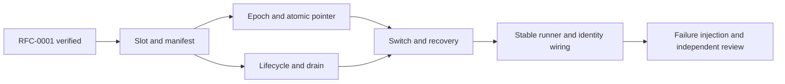

# RFC-0002: Personal runtime slots and paired data epochs

- Status: accepted; implementation depends on RFC-0001 verification
- Owner: root implementation agent
- Architecture: Fable 5.1 source audits, 2026-10-28
- Independent code reviewer: Opus 5.5
- Authority: maintainer-delegated overnight implementation decisions; no claim of human document approval

## Outcome

Build a changed Malleaf daemon, activate the exact tested artifact, and return to the previous working runtime when startup fails or its owner chooses to revert. A personal version can change every project layer, including storage. A rollback therefore selects both code and its corresponding data. Provider binaries and provider-owned conversation history remain external dependencies.

The directory structure and `@getpaseo/*` packages stay in place to retain upstream mergeability. New controller and runner packages own the independent process lifetime. The later job/agent and desktop RFCs add conversational entry points and desktop slot loading; this RFC must not label those later features complete.

## Layout and process ownership

```text
MALLEAF_HOME/
  runner/stable/runner.js       last validated, dependency-free bootstrap
  runner/current.json          current, previous, pending build/data pairs
  runner/switch.json           recoverable transaction journal
  versions/<buildId>/          immutable runtime closure and manifest
  data/<dataId>/               one complete daemon home per epoch
  source/                     user source clone and personal branch
  worktrees/                  shared worktrees outside daemon state
  plugins/                    shared installed plugin checkout contents
  models/                     shared model downloads
  jobs/                       durable customization jobs (next RFC)
```

The stable runner starts the current slot's controller. The controller starts and supervises the daemon through the public daemon-control and client APIs. It survives a daemon replacement. UI/RPC integration later uses a built-in plugin as a thin authenticated bridge; it is not required for rollback or crash recovery.

The stable runner is a last validated copy, rather than an officially locked source component. Its source remains customizable. Updating the installed stable copy requires a separate validated handoff transaction. Initial implementation establishes this layout; the handoff transaction may follow. A signed desktop bootstrap still requires repackaging when that bootstrap changes; the future desktop RFC must distinguish that from replaceable main/preload/renderer code.

## Version identity and artifact contract

Keep upstream workspace and protocol versions unchanged. `malleaf.json` records Malleaf's product version (initially `0.1.0`). A personal display string such as `0.1.0.alice-1` is presentation metadata, never a replacement for npm semver or `requirements.paseo` compatibility.

Each slot records product/display version, source commit, upstream commit, builder identity, build time, file count/size, and content hashes. `buildId` hashes a sorted list of relative paths and file hashes, excluding the slot manifest itself (which records those hashes and the resulting identity). Runtime `server_info.malleaf` is optional and includes product/display/buildId/upstream. Consumers compare build identities when both sides report them.

Build cleanly before materialization. Use the existing `trace-daemon.mjs` runtime-closure approach and physically copy workspace packages. Recreate workspace links only inside the slot. Reject missing entries, escaping links, incomplete copies, or any failed required gate; never reuse stale worktree dist. Atomically rename a fully materialized staging directory into `versions/<buildId>`.

At every launch, verify the executable entry and registered resource hashes. Full verification belongs to `malleaf doctor`; read-only permissions are an accidental-write guard. These hashes detect incomplete or changed artifacts. They do not authenticate against a local process that can rewrite both files and manifests. Candidate build scripts run arbitrary code; sanitized environment and redirected HOME reduce accidental writes and do not constitute a sandbox.

## Data and rollback contract

The atomic pointer selects `{buildId, dataId}`. After draining and stopping the old daemon, clone its durable state into a new epoch for the candidate. The previous pair remains intact. Returning to the previous pair retains the trial epoch: trial-created agents and settings become visible again when that trial pair is selected. Provider histories, project source changes, terminal side effects, and shared resources are outside the epoch boundary.

Copy by default, explicitly excluding runtime state. This preserves storage introduced by custom code without requiring the old builder to know every filename. Current known durable state includes agents, projects/workspaces/labels/icons, schedules, finish subscriptions, request receipts/creation journals, plugin settings, Hub relationship, push tokens, CLI identity, desktop attachments, `server-id`, and `daemon-keypair.json`. Identity files must be copied, not regenerated.

Exclude pid lock, local credential, logs/rotation, sockets, `runtime/`, uploads, and obsolete agent timelines. Keep worktrees, installed plugin contents, and models shared outside each epoch. Installed plugin source metadata (`plugins/sources.json`) is shared with the checkout contents. Rewrite config paths under the old epoch's `plugins/` to the new epoch's `plugins/` alias. A trial uninstall can remove a shared plugin checkout; rolling back may then leave that plugin unavailable without blocking daemon startup. A prior home with embedded worktrees needs an explicit one-time relocation before epoch copying.

Copy to `data/<id>.partial`, record provenance and hashes, then atomically rename. Use `lstat`; never follow an escaping link. Preserve internal links by rebasing them into the new epoch. For an unknown external link, stop with an actionable decision rather than silently discard possibly durable user data. The current trusted slot owns the data policy (`malleaf.data-policy.json`); undeclared paths default to copied. Large unknown data needs a copy/share decision before activation. Failed or cancelled staging leaves the previous pair usable.

Epochs are not automatically removed. Code-only rollback while retaining trial data requires a separate compatibility proof and is deferred. This avoids relying on arbitrary modified code or Zod parsing to promise backward-compatible writes.

## Drain, switch, and recovery

A controller-only idle check has a race with incoming prompts and schedules. Add a daemon-owned draining state with expiry, block new agent registrations and new turns, and pause schedules. Existing turns continue. Keep the WebSocket channel available for status, permission resolution, cancellation, and shutdown. Reusing `wsServer.prepareForShutdown()` would silence the controller too; it is not the drain mechanism.

Before draining, cold-start the candidate in a sanitized disposable home on `127.0.0.1:0`, check identity and behavior, and stop that exact process. Use daemon-control deployment mode with a constructed environment; managed mode strips listen/model overrides. Persist shared worktree/model paths in epoch config as well.

The controller begins draining, waits for running/initializing turns and pending permissions to clear, then stops the exact identified supervisor. Timeout pauses the operation with product-language choices; it does not grant permission to interrupt a turn. Cancelling or losing the controller releases the drain lease. The manager must expose reversible registration freeze and block new prompts at its admission point. Poll agent status during drain; waitForFinish is unavailable while registrations are frozen. Schedule restart on cancellation also runs upstream interrupted-run recovery. Active terminals and service scripts are disclosed because daemon replacement stops them.

Journal each step: requested, draining, stopped, copying, starting, probing, trial, kept, or rolled back. Only complete epochs and verified slots can be referenced. Startup health must match the expected buildId and server identity, then exercise a real behavior contract. The running trusted controller owns those verdicts; candidate verifier changes cannot approve the candidate itself.

On a failed candidate boot, stop the candidate if it exists, restore the previous pair, and probe recovery. Bound automatic retries (two attempts per pair). If both fail, retain both data sets and diagnostic logs and stop retrying. A stable runner restart must recover from any journal step without launching two daemons against the same state or port. Serialize all pointer-changing operations with `runner/controller.lock`; persist the controller client identity under `runner/`, using clientType `cli`.

### Recovery decisions

| Durable phase        | Recovery action                                                                  |
| -------------------- | -------------------------------------------------------------------------------- |
| requested / draining | Release drain when possible; retain the old pair                                 |
| stopped / copying    | Discard only incomplete `.partial` staging; start the old pair                   |
| starting / probing   | Stop only the recorded candidate pid + startedAt; restore and probe the old pair |
| trial                | Retain the trial pair; wait for keep or revert                                   |
| kept / rolled_back   | Terminal record; boot the selected pair                                          |

The controller hashes the selected entry itself and checks the supervisor pid/startedAt and the hello buildId against the slot manifest. Candidate-written `runtime/malleaf-entry.json` is diagnostic information, not authoritative verification. The old epoch stays untouched while inactive; starting it again may perform its normal persistence writes.

The first supported baseline includes reversible drain and runtime identity. A daemon without these capabilities requires a stopped-state import; an idle observation is not a safe fallback for draining. Existing desktop daemon ownership and attachment paths must follow the selected epoch, with built-in daemon management disabled while the controller owns the runtime.

## Tasks



| Task                                                                          | Owner       | Status  | Required evidence                                                                                                           |
| ----------------------------------------------------------------------------- | ----------- | ------- | --------------------------------------------------------------------------------------------------------------------------- |
| T1: Controller workspace, artifact manifest, materializer, hash verification  | root        | pending | Real copied closure starts; missing/escaping/changed entry fails; CI/build/knip include new workspace                       |
| T2: Default-copy epoch policy, shared resource handling, atomic pair store    | root        | pending | Unknown durable file retained; credentials/runtime excluded; partial epoch never selected; original data unchanged          |
| T3: Public daemon lifecycle adapter and reversible drain lease                | root        | pending | Real supervisor start/stop; incoming turn rejected while existing turn drains; schedule pause/resume; expiry releases lease |
| T4: Journaled activation, keep/revert, automatic failure recovery             | root        | pending | Healthy switch, failed startup, interrupted transaction, duplicate request, and previous-pair recovery                      |
| T5: Stable runner, optional build identity, desktop/controller ownership seam | root        | pending | Actual reported buildId changes; fallback survives candidate failure; desktop does not resurrect an old epoch               |
| T6: Acceptance and code review                                                | root / Opus | pending | Targeted process E2E with isolated HOME, evidence logs, review findings resolved, clear limits                              |

## Verification limits

Unit tests alone do not prove activation. Required process acceptance uses a copied slot and new epoch, confirms runtime build identity and behavior, and proves the previous epoch remains byte-for-byte recoverable after candidate failure. Mock-provider checks and real installed harness checks are reported separately. Local tests remain targeted; full-suite execution belongs to CI.

This document is design agreement, not implementation evidence. The first complete product demonstration still requires a visible UI change and a backend/orchestration change, as stated in the product brief.
